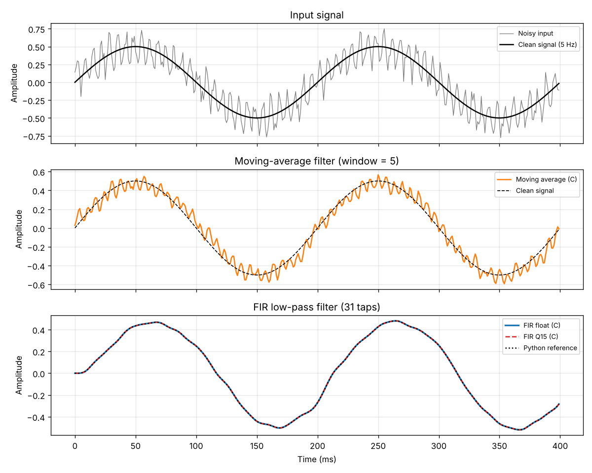
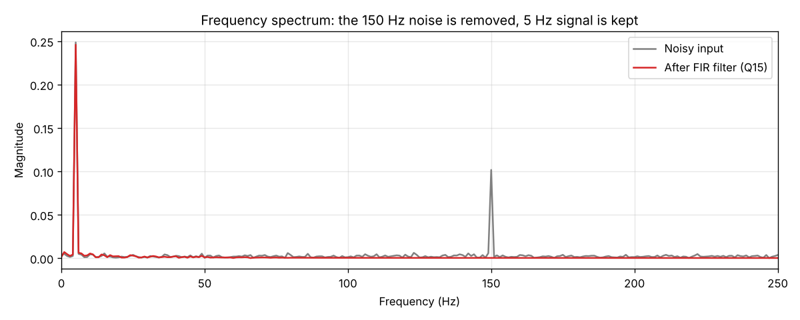

# Digital Filter Library in C

A small signal-processing library in C that removes noise from a signal. It has three filters:

| Filter | Type | What it does |
|---|---|---|
| Moving average | float | Averages the last 5 samples to smooth the signal |
| FIR low-pass | float | Keeps low frequencies (below 40 Hz) and removes high ones |
| FIR low-pass | **Q15 fixed-point** | Same filter using only integer maths, the way it is done on embedded chips |

The C output is checked against a **Python reference model**. A test script reports the error and prints PASS or FAIL.




---

## Project structure

```
dsp-filter-c/
├── src/
│   ├── filters.h            # function declarations
│   ├── filters.c            # the three filters + Q15 helpers
│   └── main.c               # reads data, runs filters, saves output, measures time
├── python/
│   ├── generate_signal.py   # step 1: creates noisy signal + FIR coefficients
│   ├── reference_model.py   # the "correct answer" in Python (NumPy)
│   └── compare.py           # step 3: compares C vs Python, makes plots
├── data/                    # input signal and coefficients (generated)
├── output/                  # C program results (generated)
├── plots/                   # result plots (generated)
├── Makefile
└── requirements.txt
```

---

## How to run

You need **gcc** (C compiler) and **Python 3**.

```bash
pip install -r requirements.txt
```

### Linux / macOS

```bash
make run
```

### Windows (or without make)

Run these from inside the `dsp-filter-c` folder:

```bash
python python/generate_signal.py
gcc -O2 -Wall src/main.c src/filters.c -o filter_app
filter_app.exe
python python/compare.py
```

(On Linux/macOS use `./filter_app` instead of `filter_app.exe`.)

### Expected output

```
C output vs Python reference
----------------------------------------------------------------------
Moving average (float) max error = 7.60e-08   SNR =  145.9 dB   PASS
FIR (float)            max error = 1.41e-07   SNR =  141.1 dB   PASS
FIR (Q15 fixed-point)  max error = 4.62e-05   SNR =   86.6 dB   PASS
----------------------------------------------------------------------
ALL TESTS PASSED
```

---

## How it works (simple explanation)

### 1. The test signal
- **Clean signal:** a slow 5 Hz sine wave. This is the part we want to keep.
- **Noise:** a fast 150 Hz sine wave plus random noise. This is the part we want to remove.
- Sampling rate is 1000 samples per second, so 1 second gives 1000 samples.

### 2. Moving-average filter
```
output[i] = (input[i] + input[i-1] + input[i-2] + input[i-3] + input[i-4]) / 5
```
Averaging nearby samples cancels out fast up-and-down changes (noise). It is simple, but it does not remove noise completely (see the orange line in the plot).

### 3. FIR filter
FIR means **Finite Impulse Response**.
```
output[i] = h[0]*input[i] + h[1]*input[i-1] + ... + h[30]*input[i-30]
```
- `h` holds the **coefficients** (31 numbers, called "taps").
- The coefficients are designed in Python (windowed-sinc method) so that frequencies below 40 Hz pass and higher frequencies are blocked.
- Each step is a **multiply-accumulate (MAC)**: multiply, then add to a running sum. DSP chips are built to do this very fast.

### 4. Fixed-point (Q15)
Many small embedded chips have no **FPU** (floating-point unit), so decimal (float) maths is slow on them. Instead, we store decimals as integers:

```
Q15 value = real value x 32768      (stored in a 16-bit integer)
0.5   ->  16384
-0.25 ->  -8192
```

Multiplying two Q15 numbers gives a Q30 number, so we **shift right by 15 bits** to get back to Q15. We also:
- use a 64-bit accumulator so the sum never overflows
- add rounding before the shift
- **saturate** (clamp) the result to the 16-bit range

The Q15 result has a small error (about 0.00005) compared to float. That is the price of using integers.

### 5. Testing against a reference model
In real firmware teams, an algorithm is first written in Python or MATLAB (the **reference model**). The C code is then tested against it. `compare.py` does exactly this, and reports:
- **Max error:** the biggest difference between the C and Python outputs
- **SNR (dB):** how small the error is compared to the signal. Higher means more accurate.

---

## What I learned
- Writing DSP filters in C using arrays and pointers
- FIR filter design and convolution
- Fixed-point (Q15) arithmetic: scaling, bit shifts, rounding, saturation
- Verifying C code against a Python reference model
- Looking at a signal in the frequency domain using FFT
